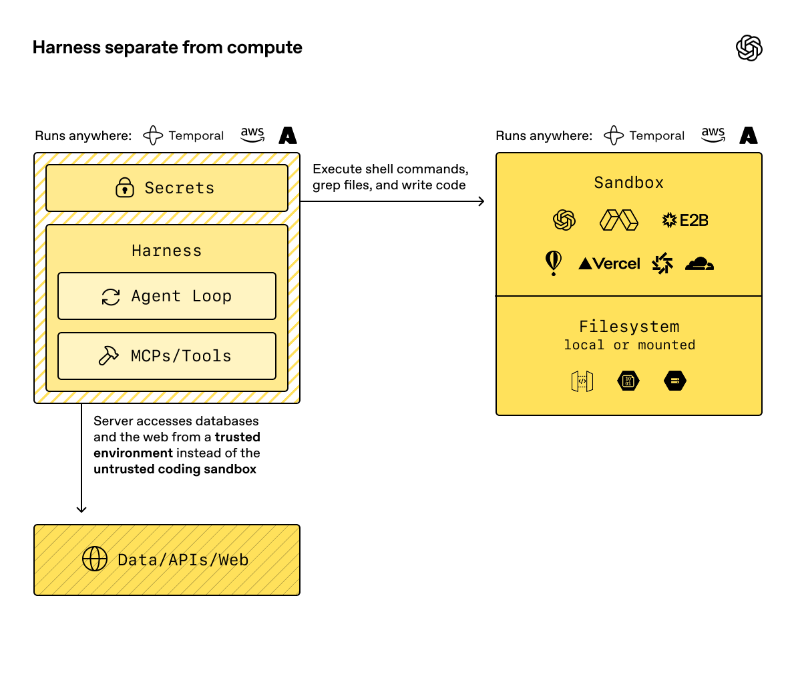

# openai-agent-mxc

[](LICENSE)

A reference implementation of **Microsoft eXecution Containers (MXC) on
Kubernetes as the sandbox for OpenAI Agents SDK `SandboxAgent`**. The SDK harness
runs in one pod with the model's API key; every shell command and file operation
runs in an MXC container on a paired sandbox worker pod that holds the
application's read-only cluster identity instead.

## Harness separate from compute

This project follows the [harness separate from compute pattern](https://developers.openai.com/api/docs/guides/agents/sandboxes) in the official OpenAI Sandbox Agents guide.



*Diagram from the [official OpenAI documentation](https://developers.openai.com/api/docs/guides/agents/sandboxes).*

`MXCSandboxClient` connects the SDK sandbox interface to an MXC sandbox worker
over gRPC. The worker gives each conversation a workspace on its volume and runs
every command in a fresh MXC container (the Bubblewrap backend on Linux) that
can see only that workspace. Each application domain gets one pair:

| Harness (`sre-harness-payments-0`) | Sandbox worker (`sre-sandbox-payments-0`) |
| --- | --- |
| The OpenAI Agents SDK, with SDK sessions for history | One workspace per conversation, kept on the worker's volume |
| ChatKit for the streaming SRE UI | An MXC container per command: shell, files, skills, kubectl, Python |
| The model's API key, and no Kubernetes token | A read-only Kubernetes identity, used only by its API proxy, and no model API key |
| Host checks of findings against recorded evidence | An audit journal and recorded evidence that no container can see |

The model loop, model calls and conversation state stay in the harness. A
command reaches the cluster only from inside an MXC container, which has no
capabilities and no credentials, a private network that reaches nothing but the
worker's read-only Kubernetes API proxy, and no view of the journal or of other
conversations. The proxy adds the worker's token and refuses anything but
reads, so the token never enters a container. Logs never reach the model raw:
containers cannot read them, and the agent's `pod_logs` tool gets them from the
worker as excerpts, with only the error and warning lines kept, repeats
collapsed, credentials and personal data masked, and a hard size cap. Plain kubectl reads are
recorded as evidence outside the containers, and the harness checks every quote
in the agent's findings against those copies. See the
[architecture](docs/architecture.md).

## Quick start

Run the SRE agent on a local Kind cluster. You need macOS with
[Colima](https://github.com/abiosoft/colima) or Linux with Docker, plus
[kind](https://kind.sigs.k8s.io/), kubectl, Node 24 or later,
[uv](https://docs.astral.sh/uv/), and an OpenAI API key.

**1. Add your OpenAI settings.** Set `OPENAI_API_KEY` and `OPENAI_MODEL` in
`.env`. Only the harness pod receives them, through a Secret; the sandbox worker
never does.

```bash
cp .env.example .env
```

**2. Set up the cluster and deploy the pair.** This starts a dedicated Colima
VM, creates the Kind cluster, builds the worker and harness images, and deploys
them with a payments application that is broken in two ways, plus a service
whose logs are full of customer data. Every command
names the `kind-openai-agent-mxc` context, and your current kubectl context is
restored afterwards. See the [local Kubernetes guide](docs/local-kubernetes.md).

```bash
make all
```

**3. Check the boundary.** Seventeen probes run in real MXC containers, then a
scripted investigation runs through the harness. No model API usage.

```bash
make verify
```

**4. Open the UI** at <http://localhost:8001>. The start screen lists the
workloads in `payments`, failing first, with why; select **Investigate** on one,
or ask which workloads are unhealthy.

```bash
make ui
```

You see each command as it runs, every one in its own MXC container. The agent
writes `output/findings.md` and `output/findings.json`; the side panel shows the
findings as cards with their proposed fixes, the kubectl reads and log excerpts
the worker recorded as evidence, the quotes the harness checked, and the turn's
trace when tracing is on. Later messages continue in the same workspace. When a
conversation goes idle, the SDK distils what it learned into the agent's
memory, which the next conversation starts with. `make loadtest` runs many conversations and users at once;
`make journal` prints the worker's audit journal; `make teardown` deletes the
cluster and stops the VM.

## The SRE agent

The [SRE agent](examples/sre/README.md) investigates unhealthy workloads with
kubectl in its sandbox, using the worker's read-only identity: it can read pods,
logs, events and workload objects in `payments`, and cannot read Secrets or
change anything. It loads a `kubernetes-triage` skill, reads the application
team's runbooks seeded into every workspace, and proposes fixes for a person to
run. It remembers across conversations through the SDK's `Memory` capability:
the harness shares each conversation's distilled lessons with the next, and the
agent cannot write memory itself. The UI is the shared SRE UI of
[openai-agent-substrate](https://github.com/SatyKrish/openai-agent-substrate), reused with its harness.

## Use the provider in your own application

The provider is the `openai-agent-mxc` package in `sandbox/`, imported as
`agent_mxc`. It implements the SDK's `BaseSandboxClient` for any `SandboxAgent`;
the worker is the image built from `worker/`. See
[SDK integration](docs/usage.md) and, for a cluster other than Kind, the
[deployment guide](docs/deployment.md).

## Verification

The provider is pinned to `openai-agents==0.24.0` and the worker to
`@microsoft/mxc-sdk` 1.0.1. On local ARM64 Kind, all seventeen boundary probes
passed in real MXC containers, including no token in the container, no direct
route to the API, and writes, exec and raw logs refused by the worker's proxy.
In a live investigation of a service that logs customer emails and card numbers,
the model's whole history held none of either. Live
investigations with `gpt-6.1-terra` ran every tool call in MXC containers and
every quote in their findings matched the worker's recorded evidence. One user
with six conversations, twelve users at once and three users on one shared
conversation all passed; with three sessions open at once, none could reach
another's workspace, evidence, logs or the worker's journal; and a pod outside
the pair could not reach the worker. With memory on, a second conversation
started from the first's lessons and confirmed them against fresh evidence;
memory held no email address, card number or credential, and a harness restart
closed an open conversation and kept its memory. An MXC command costs about
110 ms with the proxy-only network. AKS and Kata remain unverified. See the
[verification record](docs/verification.md).

## Tracing

Set `OTEL_EXPORTER_OTLP_ENDPOINT` (OTLP over HTTP, port 4318) for the harness,
and `JAEGER_URL` to its query address, to export each turn's SDK spans and the
provider's workspace and command spans. The UI then shows each turn as a
harness/sandbox timeline. Only span types, tool names and numeric metrics are
exported; prompts, commands and outputs are not. The exporter stays in the
harness.

## Repository layout

```text
pyproject.toml              uv workspace root: dev tools and test settings, no package
proto/mxc/sandbox/v1/       The harness/worker gRPC contract
worker/                     MXC sandbox worker (Node 24, TypeScript), its unit tests and a host runner for tests
sandbox/                    The provider (openai-agent-mxc): MXCSandboxClient, gRPC transport, tracing
harness/                    The shared agent harness and SRE UI (openai-harness), adapted from openai-agent-substrate
examples/sre/               The SRE agent: SandboxAgent, skill, runbooks, findings check, UI, verify and load test
deploy/docker/              Worker and harness images
deploy/kubernetes/          Kustomize base (the pair, RBAC, NetworkPolicies) and kind and AKS overlays
deploy/kind/, deploy/demo/  The Kind cluster and the broken payments workloads
docs/                       Architecture, local Kubernetes, deployment, usage, development and verification
```

## Documentation

- [Architecture and limits](docs/architecture.md)
- [Local Kubernetes setup and tests](docs/local-kubernetes.md)
- [Deploying on another cluster](docs/deployment.md)
- [SDK integration and sessions](docs/usage.md)
- [Development](docs/development.md) and the [verification record](docs/verification.md)
- [SRE agent](examples/sre/README.md)

## License

Original project code and documentation are licensed under
[Apache-2.0](LICENSE). The harness and UI derive from openai-agent-substrate
(Apache-2.0); MXC is installed from npm under MIT; the OpenAI diagram retains
its original rights. See [NOTICE](NOTICE) and
[THIRD_PARTY_NOTICES.md](THIRD_PARTY_NOTICES.md).
