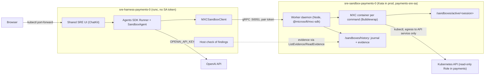

# openai-agent-mxc

A reference implementation of an **OpenAI Agents SDK `SandboxAgent` whose tools
run in Microsoft eXecution Containers (MXC) on Kubernetes**, with an SRE agent
that investigates unhealthy workloads. Each application domain gets a pair of
StatefulSets: a harness that holds the model's API key and no cluster access,
and an MXC sandbox worker that holds a read-only cluster identity and never the
model's key. The UI is the shared SRE UI from
[openai-agent-substrate](../openai-agent-substrate), reused with its harness.



## Who holds what

| | Harness pod | Sandbox worker pod | Each MXC container |
| --- | --- | --- | --- |
| Model API key | yes (Secret) | no | no |
| Kubernetes identity | none, token not mounted | `payments-sre-sa`: get/list/watch on pods, logs, events, workloads in `payments`; no Secrets, ConfigMaps, exec or writes | the same token, read-only mount, for kubectl |
| Network | DNS, its worker, HTTPS | API server ports only (NetworkPolicy) | the Kubernetes API service IP only (MXC egress rule); no DNS, no internet |
| Filesystem | its PVC: conversations, host copies | its PVC: every session's workspace and the journal | its own session's workspace, read-write; system dirs read-only; the journal and other sessions are not mounted |
| Reached by | `kubectl port-forward` (UI binds 127.0.0.1) | its harness only, gRPC + pair token | nothing |

## How a command runs

1. The SDK calls `exec` on the session; `MXCSandboxClient` sends `Exec` to the
   paired worker over gRPC (`proto/mxc/sandbox/v1/sandbox.proto`).
2. The worker runs it through `@microsoft/mxc-sdk`'s `run()` with the
   Bubblewrap backend: new user, PID, IPC, UTS and network namespaces, MXC's
   deny-by-default read-only baseline, the session workspace as the only
   writable path, a cleared environment, a socket-family seccomp filter, and an
   egress rule that admits only `KUBERNETES_SERVICE_HOST:PORT`. Inside,
   `prlimit` caps address space, CPU time and open files, and `choom` makes the
   command the kernel's first OOM victim instead of the worker.
3. Output is redacted (JWTs, cloud keys, bearer tokens, URL credentials,
   `password=`-style pairs, private keys), capped, journaled and returned.
4. A plain kubectl read (no pipes, quotes, `$` or connection-override flags) is
   also **evidence**: the worker keeps its output in `/sandboxes/history`, which
   no container can see, and saves a copy in the workspace as
   `evidence/NNN-kubectl-....txt` for the agent to analyze.
5. After the turn the harness pulls new evidence from the journal and checks
   every quote in `output/findings.json` against those copies, so editing
   `evidence/` in the sandbox cannot make a quote pass.

Files move over `WriteFile`/`ReadFile` RPCs, confined to the session workspace
lexically and again after resolving symlinks. Commands and file operations of
one session run one at a time; sessions run concurrently up to
`MXC_MAX_CONCURRENT`.

## Quick start (macOS with Colima, or Linux with Docker)

You need Docker, [kind](https://kind.sigs.k8s.io/), kubectl, Node 24+,
[uv](https://docs.astral.sh/uv/) and an OpenAI API key; on macOS also
[Colima](https://github.com/abiosoft/colima).

```bash
cp .env.example .env    # set OPENAI_API_KEY and OPENAI_MODEL
```

```bash
make all                # Colima VM, Kind cluster, images, secrets, the pair, the broken payments demo
```

```bash
make verify             # boundary probes and a scripted investigation in the cluster, no model usage
```

```bash
make loadtest           # many conversations and users at once in the cluster, no model usage
```

```bash
make ui                 # http://localhost:8001
```

Ask "What's unhealthy in payments?". The demo has a `payments-processor` that
exits without `DATABASE_URL`, a `payments-ledger` whose image tag was never
published, and a healthy `payments-gateway`. `make journal` prints the
worker's audit journal; `make teardown` deletes the cluster and stops the VM.
Every `make` target names `--context kind-openai-agent-mxc`, and `make cluster`
restores your previous kubectl context after creating the cluster.

On Linux without Colima, pass `COLIMA_PROFILE=` and make sure unprivileged user
namespaces are allowed (`kernel.apparmor_restrict_unprivileged_userns=0` on
Ubuntu 24.04+).

## Verification

Run on local ARM64 Kind (Kubernetes 1.35, kindnet) in a Colima Ubuntu 24.04
VM, with `@microsoft/mxc-sdk` 1.0.1 and `openai-agents` 0.24.0:

- **Unit and integration tests** (`make test`): 7 worker tests (evidence
  rules, redaction, path guards against planted symlinks, the gRPC service with
  its token) and 19 Python tests, which drive the provider, the harness and its
  UI routes, and the SRE agent end to end against the worker's real gRPC
  service. These run commands on the test host, not in MXC.
- **In the cluster** (`make verify`): all 13 container probes pass, each in its
  own MXC container: no capabilities, own PID namespace, journal and other
  workspaces not mounted, system files read-only, no API key, no route to
  1.1.1.1, API reachable, pods readable in `payments`, Secrets and `kube-system`
  forbidden, delete denied, credentials redacted. The harness pod has no
  Kubernetes token. A scripted investigation recorded 2 kubectl reads and its
  quotes matched the journal copies. A pod in another namespace could not reach
  the worker's port (NetworkPolicy).
- **Live** through the UI with `gpt-6.1-terra`: one question, 57 s, 19 tool
  calls all in MXC containers, 9 kubectl reads recorded as evidence, 2 findings
  (`payments-processor`, `payments-ledger`) whose 10 quotes all matched.
- **Concurrency** (`make loadtest`, a scripted model through the harness's
  HTTP API, each user its own connection): one user starting 6 conversations
  at once finished in 5.0 s; 12 users at once, more than the worker's 8
  parallel command slots, finished in 8.8 s with every turn under 8.7 s; 3
  users sending to one shared conversation at the same moment got 3 turns, run
  one after another in order, with no errors. Every conversation had its own
  workspace, its containers could see only that one, every findings check
  passed, and deleting the 19 conversations removed their 19 workspaces.
  Live, 3 users asking different questions at once finished in 55 s, about
  one investigation's time; each check passed (7, 9 and 9 quotes).
- **Cost of isolation:** about 11 ms per container without network and about
  110 ms per command round trip with the API-only network (slirp4netns and its
  rules are set up per command).

Not verified here: AKS or any Kata runtime, multi-node clusters, or load
beyond a few dozen conversations.

## Differences from the reference design

- **Python harness.** The harness uses the Python Agents SDK (`openai-agents`
  0.24.0, `SandboxAgent` and `BaseSandboxClient`) so the existing ChatKit SRE UI
  and harness run unchanged in shape. The worker is TypeScript, as designed,
  because MXC's Node SDK is how MXC is embedded.
- **MXC SDK instead of hand-built `bwrap` arguments.** Isolation details (the
  read-only baseline, `--clearenv`, the seccomp filter, slirp4netns egress
  rules) come from MXC. MXC's Node SDK offers persistent containers only for
  Windows backends, so on Linux each command is its own container over a
  persistent workspace directory.
- **Evidence, not just a journal.** The worker classifies plain kubectl reads
  and the harness checks findings against the worker's copies, as the original
  SRE agent did with its harness-side tools.
- **Kind needs a privileged worker.** Kind's nested containers mask `/proc` and
  hide `/dev/net/tun`, and user-namespaced pods do not start there, so the Kind
  overlay runs the worker container privileged (as uid 10001). Commands inside
  MXC containers still have no capabilities. The Colima VM also clears
  `kernel.apparmor_restrict_unprivileged_userns`. In production the pod's outer
  boundary is a Kata microVM (`deploy/kubernetes/overlays/aks`, unverified).
- **gRPC is authenticated.** The pair shares a token Secret, on top of
  NetworkPolicy. mTLS would be the production step.

## Limits

- Redaction is pattern-based. The worker's identity cannot read Secrets, but a
  pod spec's literal env values and application logs can still contain
  credentials it does not recognize.
- Log lines are evidence of what the application printed, not of what is true;
  the check proves quotes are real, not that the diagnosis is.
- The harness keeps conversations in SQLite on its PVC and has no sign-in
  beyond Kubernetes RBAC on port-forward. One replica per domain.
- The agent sees the service-account token file (kubectl needs it); it grants
  only the read-only Role, and the network reaches only the API.

## Layout

```text
proto/mxc/sandbox/v1/     The harness/worker gRPC contract
worker/                   MXC sandbox worker (Node 24, TypeScript): MXC runner, workspaces, journal, evidence, redaction
sandbox/                  openai-agent-mxc: MXCSandboxClient for the Agents SDK, gRPC transport, tracing
harness/                  openai-harness: the shared harness and UI, from openai-agent-substrate, adapted to MXC
examples/sre/             The SRE agent: SandboxAgent, triage skill, runbooks, findings check, UI settings, verify
deploy/docker/            Worker and harness images
deploy/kubernetes/        Kustomize base (the pair, RBAC, NetworkPolicies) and kind/aks overlays
deploy/demo/              The broken payments workloads
```

## Credits

The harness and its UI (`harness/`), the findings check and the triage script
come from openai-agent-substrate (Apache-2.0). MXC is
[microsoft/mxc](https://github.com/microsoft/mxc) (MIT), installed from npm.
This project is Apache-2.0; see [LICENSE](LICENSE) and [NOTICE](NOTICE).
