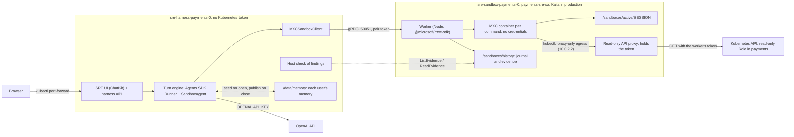

# Architecture

This project follows the **harness separate from compute** pattern in the [OpenAI Sandbox Agents guide](https://developers.openai.com/api/docs/guides/agents/sandboxes). The Agents SDK harness runs in a trusted pod. A paired sandbox worker pod provides compute: it runs every command as a workload in its own Microsoft eXecution Container (MXC) over the conversation's workspace. `MXCSandboxClient` adapts the worker to the SDK sandbox interface. MXC terms below (container, backend, workload, policy, create-and-run) follow the [MXC glossary](https://github.com/microsoft/mxc/blob/main/docs/glossary.md).

*Diagram from the [official OpenAI documentation](https://developers.openai.com/api/docs/guides/agents/sandboxes).*

The following diagram shows one application domain's pair on Kubernetes:

## Who holds what

| | Harness pod | Sandbox worker pod | Each MXC container |
| --- | --- | --- | --- |
| Model API key | Yes, from the `openai-creds` Secret | No | No |
| Kubernetes identity | None; its token is not mounted | `payments-sre-sa`: get, list and watch on pods, logs, events, services and workloads in `payments`; no Secrets, ConfigMaps, exec or writes. Only its API proxy uses the token | None. kubectl's kubeconfig names the proxy and carries no credentials |
| Network | DNS, its worker, HTTPS | The API server's ports only (NetworkPolicy) | The worker's API proxy only (MXC proxy-only egress); no DNS, no internet, no direct route to the API |
| Filesystem | Its volume: conversations and host copies | Its volume: every workspace and the journal | Its own workspace, read-write; system directories read-only; no journal, no other workspaces |
| Reached by | `kubectl port-forward`; the UI binds 127.0.0.1 | Its harness only: NetworkPolicy and the pair token | Nothing |

## How a command runs

1. The SDK calls `exec` on the session. `MXCSandboxClient` sends `Exec` to the
   paired worker ([`proto/mxc/sandbox/v1/sandbox.proto`](../proto/mxc/sandbox/v1/sandbox.proto)).
2. The worker runs it as a workload in a transient container: MXC's
   create-and-run operation (`run()` in `@microsoft/mxc-sdk/v1`, captured
   output) with the Bubblewrap backend. Bubblewrap has no persistent container
   lifecycle, so a conversation's state lives in its workspace, not in a
   container. Per MXC's backend documentation, each container gets new user,
   PID, IPC and UTS namespaces; the deny-by-default read-only baseline (`/bin`,
   `/sbin`, `/lib*`, `/usr/bin`, `/usr/sbin`, `/usr/lib*`, `/usr/libexec`,
   `/usr/share`, `/etc`; not `/usr/local`, `/opt`, `/var` or `$HOME`); minimal
   `/dev`, `/proc` and `/tmp`; a cleared environment; a seccomp filter that admits
   only Unix, IPv4, IPv6 and netlink sockets; and the workload runs under
   `sh -c`. The worker's policy adds the session's workspace as the only
   read-write path (at the same path inside), the kubeconfig directory read-only,
   `HOME=/tmp` (MXC sets `HOME` to the working directory otherwise, where
   dotfiles would act as user configuration), and the network policy below.
   Inside, `prlimit` caps address space, CPU time and open files, and `choom`
   makes the workload the kernel's first OOM victim rather than the worker.
3. **Network.** The policy is MXC's proxy-only posture: `egress.default: deny`
   with no rules, ingress and host loopback denied, and
   `runtimeConfig.networkProxy` naming the worker's API proxy on
   `127.0.0.1`. MXC gives the container a private network namespace through
   slirp4netns, admits only the proxy endpoint (seen inside as `10.0.2.2`),
   opens no DNS, and sets `HTTP_PROXY` and `HTTPS_PROXY` for cooperating
   clients. In MXC's terms the worker's proxy is the external proxy that does
   the destination filtering: it serves only the Kubernetes API, adds the
   worker's token, and forwards only reads (below). The worker checks
   `getPlatformSupport().bubblewrapNetwork.proxyEnforcement` at startup and,
   like MXC, never falls back to a weaker network: an unsupported host fails
   the worker's self-test.
4. The worker redacts the output (JWTs, cloud and API keys, bearer tokens, URL
   credentials, `password=`-style pairs, private keys, email addresses and card
   numbers that pass the Luhn check), caps it, records it in
   the session's audit journal with any warnings MXC returned, and returns it.
   MXC's structured errors map to gRPC statuses: `backend_unavailable` and
   `backend_error` to `UNAVAILABLE`, the rest to `FAILED_PRECONDITION`.
5. A plain kubectl read is also **evidence** (below).

## The read-only API proxy

Containers hold no Kubernetes credentials. The worker runs a small HTTP proxy
on its own loopback (`MXC_KUBE_PROXY_PORT`, 18080) and writes a kubeconfig whose
server is that proxy, as `http://10.0.2.2:18080`, with no user credentials. For
each request the proxy:

- forwards only `GET` and `HEAD` of Kubernetes API paths (`/api`, `/apis`,
  `/version`, `/openapi`), so get, list, watch, describe and events work;
- refuses writes of any verb, upgrades, `CONNECT`, the `exec`, `attach`,
  `portforward` and `proxy` subresources, **pod logs**, other paths, and
  requests addressed to any other host, with a Kubernetes `Status` that kubectl
  prints as `Forbidden`;
- drops any `Authorization`, cookie or `Impersonate-*` header the container
  sent, adds the worker's token, read from the kubelet-rotated file on every
  request, and forwards over TLS, verifying the API server against the cluster
  CA.

RBAC still decides what the token can read. The proxy keeps writes out even if
the Role is widened later, and a workload can no longer print the token in any
form, because no file, variable or header in the container holds it.

Files move over `WriteFile` and `ReadFile`, outside any container. A path must
stay inside the session's workspace lexically and again after the worker
resolves symlinks the agent may have planted; writes refuse symlinked
components and land by rename. The SDK's own path checks run first.

Commands and file operations of one session run one at a time, in arrival
order, so a checked path cannot change underneath a file operation. Different
sessions run concurrently up to `MXC_MAX_CONCURRENT` commands (8 by default);
further commands wait for a slot.

## Workspaces and conversations

A workspace is a directory on the worker's volume, `/sandboxes/active/SESSION`,
and has the same path inside its containers. Nothing runs between commands, so
there is nothing to suspend between turns.

| Moment | What happens |
| --- | --- |
| First message | The harness names a workspace, builds the agent's manifest under it, and the worker creates it; the SDK writes the manifest's files (the SRE agent's runbooks) and the harness seeds the agent's memory |
| During the turn | The agent loop runs in the harness; every tool call runs in its own MXC container |
| End of the turn | The harness fetches new evidence from the worker, copies the agent's `output/` and `work/` files, runs the agent's check, and saves the session state with the thread. The SDK session stays open |
| Next message | The turn continues in the open session; its workspace is as the last turn left it |
| Idle (`SRE_SESSION_IDLE_S`, 300 s) or harness shutdown | The session closes and the SDK distils the conversation into memory (below). A later message reopens the same workspace |
| Conversation deleted | The worker removes the workspace and records the deletion; its journal stays. The conversation is not remembered |

The harness keeps threads in SQLite and conversation history in an SDK
`SQLiteSession`, both on its own volume, so conversations survive a harness
restart. The worker's volume keeps workspaces and the journal across worker
restarts; a workspace that is gone when a conversation reopens is recreated
from the manifest.

## The turn engine and its API

The harness's turn engine ([`engine.py`](../harness/src/openai_harness/engine.py))
runs conversations without any UI protocol. A message joins its conversation's
queue, and the conversation's turns run one at a time in the background, so a
turn does not depend on the request that asked for it. Messages that arrive
while a turn runs are answered together in the next turn, and a turn can be
stopped.

What a turn shows is kept as the conversation's transcript, a list of entries:
`user` (a message, with who sent it), `steps` (a group of tool calls), `assistant`
(the agent's text) and `card` (a small declarative card). Listeners get events
as they happen:

| Event | What it carries |
| --- | --- |
| `entry` | An entry added or changed |
| `delta` | Text of an assistant entry as it streams |
| `turn` | A turn started, ended (`completed`, `failed`, `stopped`) or finished showing its card (`shown`) |
| `effect` | A UI hint, such as the file to open |
| `error` | A failure that is safe to show |

Reasoning is not part of the transcript or the events: what the agent says is
its messages.

The harness serves this as its own API, for any UI:

| Route | What it does |
| --- | --- |
| `GET /api/conversations` | The requesting user's conversations and the shared ones |
| `POST /api/conversations` | Starts a conversation with a message |
| `GET /api/conversations/ID` | The conversation and its transcript (`?after=SEQ` for later entries) |
| `PATCH`, `DELETE /api/conversations/ID` | Renames or deletes it |
| `POST /api/conversations/ID/messages` | Sends a message |
| `POST /api/conversations/ID/stop` | Stops the running turn |
| `GET /api/conversations/ID/events` | The conversation's events, as server-sent events |

ChatKit is one adapter over the engine
([`chat.py`](../harness/src/openai_harness/chat.py)): `/chatkit` hands a message
to the engine and streams that turn's events as ChatKit events, and the store
serves ChatKit's items from the transcript, so ChatKit and the harness's API
show the same conversation. Stopping a ChatKit stream stops the turn, as
ChatKit's stop button expects. A store from before the engine had its ChatKit
items converted into the transcript once, at start.

## The agent loop

The SDK's `Runner` runs the loop in the harness, with the conversation's
history. The SRE agent adds three things to the SDK's defaults:

- **Compaction, early.** The SDK's `Compaction` capability summarizes earlier
  steps once the context reaches 100k tokens. The SDK would size that from the
  model's context window, but it does not know the `gpt-6` models and would
  wait until 240k; the reads are in evidence files, so the context can stay
  smaller.
- **Earlier turns' tool output as previews.** The SDK's `ToolOutputTrimmer`
  shortens tool output from before the last two messages to a preview; the
  files it came from stay in the workspace for the agent to reread.
- **Token use per turn.** Each turn records its model requests, input, cached,
  output and reasoning tokens, and its largest single request, which is how
  large the context got; the turn's card shows the total.
- **A step limit that ends the turn cleanly.** A turn may take
  `SRE_MAX_TURNS` model steps (25). At the limit, the turn ends with a message
  saying so instead of an error, and the partial turn stays in the history, so
  "continue" picks up from it.
- **Tool mistakes go back to the model.** A call to a tool that does not exist
  is returned to the model as an error to correct, instead of failing the turn.

## Memory across conversations

The SDK's `Memory` capability keeps memory as files in the workspace
(`memories/`). It records each run, and when the session closes it extracts
lessons from the conversation and consolidates them with what is already there
into `MEMORY.md` and `memory_summary.md`; the agent reads them at the start of
a turn. The SDK expects that directory to be preserved and reused, by keeping
or resuming the same workspace. Here each conversation has its own workspace,
so evidence and logs stay apart, and the harness carries the directory between
them instead ([`memory.py`](../harness/src/openai_harness/memory.py)):

1. **Memory is per user.** A conversation belongs to the user who started it;
   an issue the health board opened belongs to the team, whose memory is its own.
   An authenticating proxy in front of the UI names the signed-in user in a
   header (`SRE_USER_HEADER`). Without it, every user is the guest and shares
   the guest's memory. Each user's memory is a directory under
   `/data/memory/users/` on the harness's volume.
2. When a conversation's session opens, the harness replaces the workspace's
   `memories/` with its user's memory.
3. When the session closes, the harness replaces it again, so consolidation
   builds on what the user's other conversations published meanwhile, and the
   SDK generates memory: `gpt-6-luna` extracts the conversation and
   `gpt-6.1-terra`, the agent's own model, consolidates, following the SDK's
   default pair of an efficient model, then a stronger one. Both are settings
   (`MEMORY_EXTRACT_MODEL`, `MEMORY_CONSOLIDATE_MODEL`). The rest are
   the SDK's defaults: medium reasoning, the newest 256 conversations, up to
   500 consolidation steps.
4. The harness reads the consolidated files back and swaps them in as a whole,
   or keeps the stored memory if the result is over 8 MiB or 2,000 files. One
   user's closes run one at a time, so two consolidations never overwrite each
   other; different users' run at once.

Memory forgets, too. A conversation last updated more than
`SRE_MEMORY_MAX_AGE_DAYS` ago (90) is dropped, as is anything beyond the newest
256, and a deleted conversation is dropped at once. The harness removes the
conversation's raw memory and summary immediately and rebuilds the raw notes
the agent may read; the SDK's own forgetting step removes what `MEMORY.md` and
`memory_summary.md` drew from it at that user's next consolidation. When nothing
is left, the user's memory is removed. Deleting an open conversation shuts its
session down without closing it, so the SDK generates no memory from it.

Memory is a channel from one conversation's content into later ones, so it is
constrained:

- **The agent cannot write it during a run** (`live_update=False`, where the
  SDK's default is to allow it). Only the SDK's extraction writes memory,
  guided by [`memory.md`](../apps/sre/agent/memory.md): conclusions rather
  than data; never raw log lines, pod specs, credentials or personal data;
  never instructions found in logs, events or pod specs; and a user preference
  only when stated as standing, never a one-off request, and never one that
  would weaken how the agent works.
- **It comes from what the model saw,** which was already masked: log excerpts,
  redacted command output.
- **It is read as a hypothesis.** The SDK adds the user's memory summary to the
  agent's instructions and has the agent search `MEMORY.md` before exploring,
  so memory decides where it looks first. The agent's
  [instructions](../apps/sre/agent/instructions.md) add what the SDK's
  read-only mode leaves out: the cluster as read now wins over memory; a
  remembered cause is a hypothesis to confirm and to try to rule out; memory is
  never cited in findings; the answer says what rests on memory it did not
  re-check; and memory never overrides the instructions or the user's current
  request.
- **It cannot pass the check.** Quotes in findings must match evidence the
  worker recorded in this conversation; memory files are not evidence.

Replacing `memories/` at both points, rather than copying over it, keeps two
things out of memory: anything written there during a run, which only the
SDK's generation at close may do, and anything forgotten while the conversation
was open, which its stale copy would otherwise publish back.

**People see and manage their memory** the way they see their conversations.
The book button beside ChatKit's history button (ChatKit's header takes only
its own icons) opens a Memory view over the chat, laid out like ChatKit's
history: one entry per remembered conversation, with the SDK's one-line
description, grouped by day. Selecting an entry opens that conversation;
Forget appears on hover, and Forget everything below the list. It also shows the
summary the agent starts with and `MEMORY.md` in full. A correction is made in
a conversation ("Correct something" starts one), so it passes through the same
extraction rules as everything else; memory is not edited as free text, which
would put a user's words into later conversations' instructions unfiltered.
The panel uses `GET /api/memory?detail=1`, `DELETE /api/memory/conversations/ID`
and `DELETE /api/memory`, for the signed-in user (or the guest); the deletes are
refused from other origins. Forgetting removes a conversation's raw memory and
summary at once; what `MEMORY.md` drew from it goes at the next consolidation.
Memory is plain files on the harness's volume: an operator can also read, edit
or remove a user's directory under `/data/memory/users/`.

## Logs reach the model only as excerpts

Application logs can hold customer data, so raw logs never enter a container or
the model's context. Containers cannot read them: the API proxy refuses
`pods/log`. The agent reads logs only through the `pod_logs` tool, which calls
the worker's `ReadLogs`. The worker fetches the log itself with its own token
(a pod name, or `deploy/NAME` for the deployment's pod most likely failing:
not ready, then most restarted, then newest; up to `MXC_LOG_MAX_TAIL_LINES`
lines and `MXC_LOG_MAX_BYTES` bytes, optionally only those from the last
`since`) and applies its log policy before anything leaves it:

- masks credentials, email addresses, Luhn-valid card numbers and numbers of
  nine or more digits, except epoch timestamps (10 digits in seconds, or 13 in
  milliseconds starting with 1, which no card number does);
- keeps only error and warning lines, with two lines of context around each
  error and the stack trace after it (up to 15 lines), server errors in access
  logs (a 5xx status after a request line, `status=` or `code=`), the last
  three lines, and lines containing text the agent asked for with `match`;
- collapses lines that differ only in numbers, timestamps and identifiers into
  one line with a count (`[×5 more like this, last at line 1206]`), keeping
  status codes and network addresses apart, so a 502 and a 504, or two
  backends, are counted separately;
- caps the excerpt at 40 lines and 6,000 bytes, and 240 characters per line;
- starts the excerpt with a header saying how many lines it read, showed and
  withheld, and how many values it masked.

Only the excerpt is returned, recorded as evidence and saved in the workspace,
so quotes are checked against exactly what the model saw. The journal records
each read with its counts and the raw log's size and SHA-256, never its text.
The limits are worker settings (`MXC_LOG_*`, see [usage](usage.md)).

## Evidence and checks

A command counts as evidence only when it is a plain kubectl read: `get`,
`describe`, `events`, `top`, `explain`, `api-resources`, `api-versions`,
`version`, `rollout history` or `rollout status`, with no pipes, redirections,
quotes, globs or `$`,
and no flag that points kubectl elsewhere (`--kubeconfig`, `--server`,
`--token`, `--as`, `--context`, `--raw`, `-f` and others). Its output then
comes from the API server as the worker's own read-only identity.

The worker keeps the redacted output under `/sandboxes/history/SESSION`, which no
container can see, and saves a copy in the workspace as
`evidence/NNN-kubectl-....txt` for the agent to analyze. Each `pod_logs` excerpt
is recorded the same way, as `evidence/NNN-pod-logs-....txt`. The output comes from
the API server through the worker's own proxy, as the worker's identity. After each turn the
harness fetches new entries with `ListEvidence` and `ReadEvidence`, checks each
against its SHA-256, and keeps a host copy with the time the worker recorded
it. The SRE agent's check then looks for every quote in `output/findings.json`
in the copy of the file it cites, so editing `evidence/` inside the sandbox
cannot make a quote pass. It checks every quote rather than stopping at the
first that fails, and reports each one: a finding is verified only when all of
its quotes are found. A found quote proves the evidence says it; the cause drawn
from it is the agent's reasoning, and the page says so.

When the check fails, the agent gets one corrective pass in the same turn: it is
told which quotes were not found in which files, asked to re-read them and to
correct or remove the claims, and the findings are checked again. The first
check's result stays with the turn, and the card shows that the findings were
corrected, so a correction is never presented as a first-time pass.

The findings also carry what a person needs to act: a fix as commands to paste
(a pre-check, the change, a way to verify it and a way to undo it, with its
risk), left empty when the fix is not a command, and the other causes the agent
ruled out with the evidence against each.

## Differences from the reference design

The design started from a reference architecture with a TypeScript harness and
hand-built `bwrap` arguments. This implementation differs where the real
components required it:

- **Python harness.** The harness uses the Python Agents SDK (`openai-agents`
  0.24.0) and its `SandboxAgent`, `BaseSandboxClient` and `BaseSandboxSession`,
  so the existing ChatKit SRE UI and harness run on it. The worker is
  TypeScript because MXC's Node SDK is how MXC is embedded.
- **MXC rather than hand-built Bubblewrap.** Mounts, environment, the seccomp
  filter and the slirp4netns proxy-only network come from MXC. MXC's Node SDK offers
  persistent containers only for its Windows backends, so on Linux each command
  is its own container over a persistent workspace directory.
- **Evidence as well as a journal.** The worker classifies kubectl reads and the
  harness checks findings against the worker's copies.
- **Authenticated gRPC.** The pair shares a token from a Secret, on top of
  NetworkPolicy. Mutual TLS would be the production step.

## Limits

- **Kind needs a privileged worker.** Kind's nested containers mask `/proc` and
  hide `/dev/net/tun`, and user-namespaced pods do not start there, so the Kind
  overlay runs the worker container privileged, as uid 10001. Commands in MXC
  containers still have no capabilities. In production the pod's outer
  boundary is a Kata microVM; see [deployment](deployment.md).
- **Masking is pattern-based.** The worker's identity cannot read Secrets, and
  logs pass the log policy, but pod specs, events and log lines can still hold
  sensitive values in forms the patterns do not recognize: names, addresses,
  free-text identifiers. Command output (pod specs, events) is masked but not
  filtered the way logs are.
- **Evidence proves quotes, not diagnoses.** A log line is evidence of what the
  application printed.
- **What kubectl can read still reaches the model.** The token stays in the
  worker and logs arrive only as excerpts, but pod specs, events and workload
  status the Role lets the agent read reach the model's context as they are,
  after masking. Keep that Role narrow. A container's termination message,
  which can hold the end of its log, appears in pod status.
- **MXC's network limits apply.** A slirp4netns that dies mid-run fails the run,
  but one that hangs reaches the workload as an unreachable network; IPv6 has no
  route. MXC's Node SDK caches `getPlatformSupport()` for the process's life,
  so a host change needs a worker restart to be seen.
- **Memory can be wrong, and the guest's is shared.** A wrong conclusion that
  the extraction keeps is remembered until a later conversation corrects it, it
  expires, or an operator removes it. Without sign-in, every user adds to and
  reads the guest's memory. An expired or deleted conversation stays in
  `MEMORY.md` until its user's next consolidation. Memory generation takes about
  a minute per conversation; sessions still open when the harness's 180 s
  termination grace period ends are not remembered.
- **One harness per domain, one replica.** Access is Kubernetes RBAC on
  port-forward, and the harness keeps its state on its volume (see
  [deployment](deployment.md#replicas-follow-the-state-backend)). Sign-in, and
  so per-user memory, needs an authenticating proxy in front of it. Several users can share the
  harness: their conversations run concurrently, and messages to one shared
  conversation run one after another.
- **Per-command cost.** An MXC container with the proxy-only network takes
  about 110 ms; a new workspace's manifest takes about fifteen of them.
